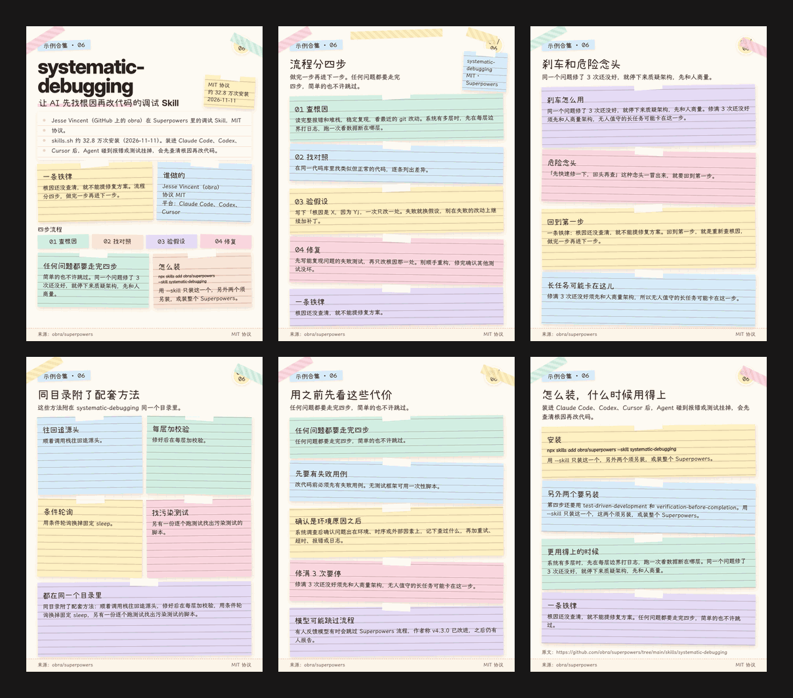
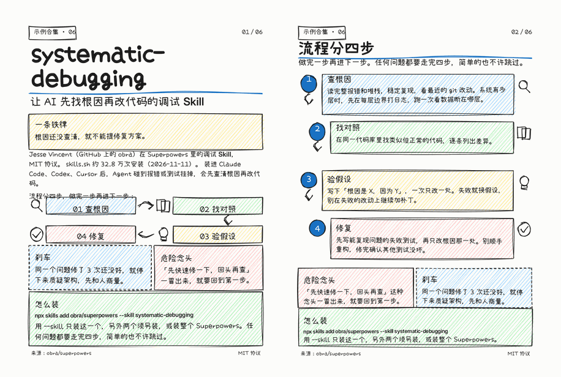
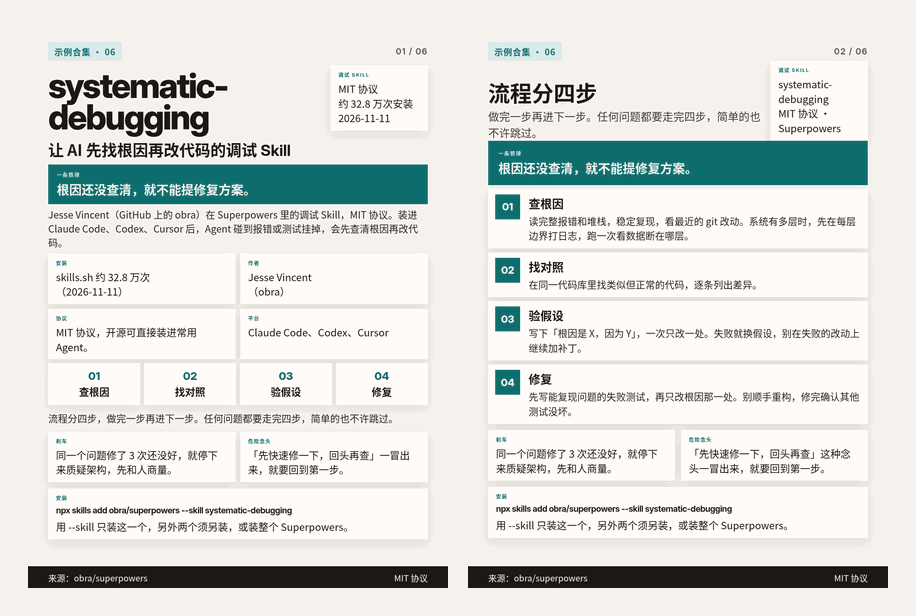

# social-media-skills

给写 AI / 开发者向社媒内容的 Agent 用的一组可安装 Skill。

[](LICENSE)
[](#skill-一览)

本仓库把选题把关、文案、小红书 3:4 配图和发布，以及 X 帖写法，拆成 7 个独立 Skill。给需要用 Claude、Codex、Cursor 这类 Agent 持续产出技术向小红书笔记或 X 内容的人用。只做其中一个环节时，直接打开对应目录的 `SKILL.md`；一次要走完整条流水线时，先读 [`social-content-router`](skills/social-content-router/SKILL.md)。

## 目录

- [Skill 一览](#skill-一览)
- [推荐流程](#推荐流程)
- [安装](#安装)
- [快速开始](#快速开始)
- [偏好层](#偏好层)
- [卡片风格](#卡片风格)
- [仓库结构](#仓库结构)
- [贡献](#贡献)
- [授权与致谢](#授权与致谢)

## Skill 一览

| Skill | 何时用 | 做什么 |
|---|---|---|
| [`social-content-router`](skills/social-content-router/SKILL.md) | 一条内容要跨选题、写作、配图、发布多个环节 | 规定顺序，以及每一步该读哪个 skill |
| [`content-quality-gate`](skills/content-quality-gate/SKILL.md) | 决定这条值不值得发，或发前要查重、实测到什么程度 | 选题过滤、已发查重、七项门槛、九种增量、隔离环境实测与取证 |
| [`xhs-series-formats`](skills/xhs-series-formats/SKILL.md) | 已定题，要按内容类型搭结构 | 常青技巧、测评、扫盲、新闻与榜单、功能介绍、解读、周报七种结构 |
| [`social-copywriting`](skills/social-copywriting/SKILL.md) | 写或改标题、正文、话题、图卡上的字 | 标题与字数规则、句子写法（主语、用词、语序）、禁用句式与问句式小标题、去 AI 味、`lint_copy.py` |
| [`x-posting`](skills/x-posting/SKILL.md) | 写 X 原创、引用或回复 | 转述他人 Tips 用引用转发、增量写法、中文短帖、一键 intent 链接；共用语言规则见 copywriting |
| [`xhs-card-design`](skills/xhs-card-design/SKILL.md) | 文字稿已确认，要做小红书 3:4 配图 | 规划每张放什么、选风格、HTML 模板渲染、`check_cards.py` 留白检查 |
| [`xhs-publish`](skills/xhs-publish/SKILL.md) | 稿和图片都已确认，要发到创作服务平台 | 发布前自查、上传顺序、蓝色话题、遇登录或验证码即停、发布后回写 |

各 Skill 可单独使用。

## 推荐流程

跨环节时按 `social-content-router` 的顺序走：

1. **选题与实测** — `content-quality-gate`：对照已发清单，过七项门槛，可实测项留下 `verify/` 日志。
2. **定类型** — `xhs-series-formats`：在稿件头部写明类型，按该类型的结构写。
3. **写文案** — `social-copywriting`（X 另读 `x-posting`）：`lint_copy.py` 输出 PASS，并按需做去 AI 味。
4. **交文字稿确认** — 用户点头之前不做图。
5. **配图** — `xhs-card-design`：`check_cards.py` 输出 PASS，且逐张看过。
6. **发布** — 小红书走 `xhs-publish`，X 用 `x-posting` 的 intent 链接。未经确认不发布；登录页或验证码出现即停。

## 安装

```bash
# 推荐：skills CLI
npx skills add LAwLi3tCoding/social-media-skills

# 或手动拷贝到 Agent 的 skills 目录（任选其一）
cp -R skills/* ~/.claude/skills/
cp -R skills/* ~/.agents/skills/
```

装好后按各目录下的 `SKILL.md` 使用。

### 依赖（按需）

- **social-content-router**、**content-quality-gate**、**xhs-series-formats**、**x-posting**、**xhs-publish**：无额外运行时依赖（发布在浏览器里操作；查重和自查会用到 shell / `rg`）。
- **social-copywriting**：Python 3。可选去 AI 味检测：[lieflat-less-ai-tone](https://github.com/larashero3-dotcom/lieflat-less-ai-tone)（**CC BY-NC 4.0，不随本仓库分发**）。
  ```bash
  npx skills add larashero3-dotcom/lieflat-less-ai-tone -g -y
  ```
  另可配合任一 `unslop` 类 skill 再砍一遍套话（可选）。
- **xhs-card-design**：
  - Chrome / Chromium（`scripts/render_html.sh`）
  - Python 3 + Pillow + numpy（`scripts/check_cards.py`，以及部分模板的 `gen.py`）
  - Node + playwright（Apple / 手绘模板的 `shot.mjs`）：`npm i playwright`，或设置 `PLAYWRIGHT_MJS`
  - 中文字体**不进仓库**（体积与授权）：装到 `$FONTS_DIR` 后运行 `scripts/relocate.sh`，把模板里的 `__FONTS_DIR__` 换成本机路径。默认目录是 `~/.local/share/fonts/xhs-card-design`。像素风字体 Fusion Pixel（OFL）需自行下载，说明见 `skills/xhs-card-design/templates/pixel/assets/fonts/OFL-fusion-pixel.txt`。
  - 可选 Swiss / Editorial 渲染：[guizang-social-card-skill](https://github.com/op7418/guizang-social-card-skill)（**AGPL，不随本仓库分发**）
    ```bash
    npx skills add op7418/guizang-social-card-skill -g -y
    ```

## 快速开始

假设当前目录是本仓库根目录，已有 `title.txt`、`body.txt`、`tags.txt`：

```bash
# 文案自查（标题 ≤20 字，正文+话题 ≤1000 字，扫禁用句式）
python3 skills/social-copywriting/scripts/lint_copy.py \
  --title title.txt --body body.txt --tags tags.txt

# 读取偏好层里 `ban:` 行追加禁用词
python3 skills/social-copywriting/scripts/lint_copy.py \
  --body body.txt --profile ~/.claude/skills/content-profile/SKILL.md

# 装好字体后跑一次，把模板里的 __FONTS_DIR__ 换成本地路径
FONTS_DIR=~/fonts ./skills/xhs-card-design/scripts/relocate.sh

# 渲染一张示例卡片并做留白检查
./skills/xhs-card-design/scripts/render_html.sh \
  skills/xhs-card-design/templates/sticky/01.html /tmp/01.png
python3 skills/xhs-card-design/scripts/check_cards.py /tmp/01.png
```

X 帖的 intent 链接拼法见 [`x-posting`](skills/x-posting/SKILL.md)；小红书发布步骤见 [`xhs-publish`](skills/xhs-publish/SKILL.md)。

## 偏好层

通用 skill 只写可复用的方法。账号、合集、口吻、额外禁用词、本机路径放在你自己的偏好层（例如已安装的 `content-profile`）。两者冲突时，以偏好层为准。

空白模板在 [`profile-template/TEMPLATE.md`](profile-template/TEMPLATE.md)。复制为你自己的 skill（例如 `content-profile/SKILL.md`）后填写。`lint_copy.py` 会读取该文件里 `ban:` 开头的行（逗号分隔）作为额外禁用词：

```bash
python3 skills/social-copywriting/scripts/lint_copy.py \
  --title title.txt --body body.txt --tags tags.txt \
  --profile ~/.claude/skills/content-profile/SKILL.md
```

也可以临时用 `--extra-ban '词1,词2'`，不必改默认列表。填好的个人偏好不要提交回本仓库。

## 卡片风格

`xhs-card-design` 自带十余种 1080×1440 模板，明细与适用场景见 [`references/styles.md`](skills/xhs-card-design/references/styles.md)。下面三套有现成预览（角标为「示例合集」）：

<table>
  <tr>
    <td align="center" valign="top">便签墙<br></td>
    <td align="center" valign="top">手绘<br></td>
    <td align="center" valign="top">卡片编号<br></td>
  </tr>
</table>

其他随包模板：

| 风格 | 路径 |
|---|---|
| Apple 产品页 | [`templates/apple/`](skills/xhs-card-design/templates/apple/) |
| 像素游戏 | [`templates/pixel/`](skills/xhs-card-design/templates/pixel/)，原样张 `classic/s4.html` |
| 新粗野撞色 / 黑板粉笔 / 3D 黏土 / 复古报纸 | `classic/s1.html`–`s5.html` |
| 杂志大排版 | [`templates/magazine/`](skills/xhs-card-design/templates/magazine/) |
| 研究简报 | [`templates/brief_renderer/`](skills/xhs-card-design/templates/brief_renderer/) |
| 手绘·蜡笔彩铅 / 手绘·白板 | `doodle/d_crayon.html`、`doodle/d_excalidraw.html` |
| 备选样张 | 马卡龙手账 `classic/s6.html`、视觉笔记 `doodle/d_sketchnote.html` |

Swiss / Editorial 风格来自可选外部包 guizang，不在本仓库内。

## 仓库结构

```
skills/
  social-content-router/     SKILL.md
  content-quality-gate/      SKILL.md
  xhs-series-formats/        SKILL.md
  social-copywriting/        SKILL.md、scripts/lint_copy.py、references/
  x-posting/                 SKILL.md
  xhs-card-design/           SKILL.md、scripts/、templates/、references/
  xhs-publish/               SKILL.md
profile-template/
  TEMPLATE.md
LICENSE
README.md
```

## 贡献

欢迎提 Issue 和 PR。填好的个人偏好、本机路径和账号信息不要提交。改 skill 行为时请对准现有 `SKILL.md` 的约定，并说明你做过的验证。

## 授权与致谢

| 组件 | 授权 | 是否在本仓库 |
|---|---|---|
| 本仓库代码与模板 | MIT | 是 |
| rough.js（`doodle/`、`handdrawn/` 手绘模板） | MIT | 是（minified，附 `ROUGHJS-LICENSE.txt`） |
| Fusion Pixel 等字体 | 各字体自身许可（多为 OFL / SIL） | **否**，只给下载说明，用 `__FONTS_DIR__` 占位 |
| guizang-social-card | AGPL | **否**，只给安装命令 |
| lieflat-less-ai-tone | CC BY-NC 4.0 | **否**，只给安装命令 |
| creator-buddy / xhs-html | 见上游 | **否**，只作可选外部工具提及 |

Owner: [LAwLi3tCoding](https://github.com/LAwLi3tCoding)
